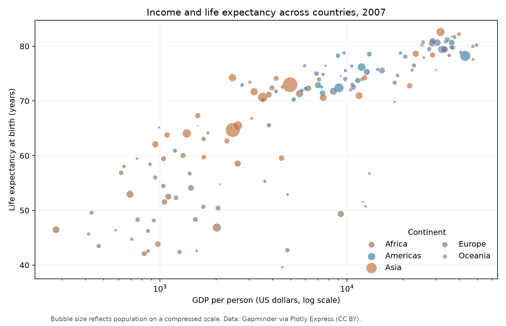
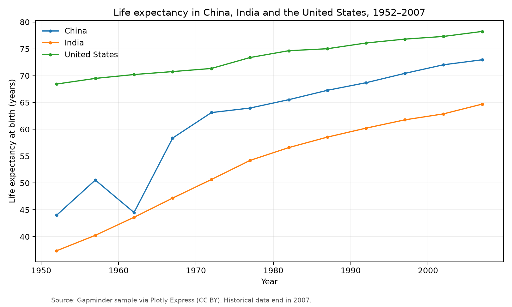

# HE JIAXIN

I am studying data science and data visualization in CISC7204. I am interested in using clear visualizations to make comparisons understandable without overstating what the data can prove.

## Skills I am developing

Python · Pandas · Matplotlib · Plotly · data cleaning · chart design · reproducible analysis

## Project: Income and life expectancy, 1952–2007

**Research question:** How did life expectancy relate to GDP per person across countries in 2007, and how did life expectancy change in China, India, and the United States over the preceding decades?

The 2007 comparison shows a positive association, with substantial differences between countries at similar income levels. The horizontal scale is logarithmic so low- and high-income countries can be read on the same chart.

The time-series chart adds a perspective that the snapshot misses: life expectancy improved in all three countries between 1952 and 2007, though at different rates.

- [Project code, data description, and reproduction instructions](https://github.com/xinnnnD728/data-science-project)
- **Status:** completed as a small historical visualization exercise; future work could use newer observations and examine inequality within countries.

Data: based on free data from [Gapminder.org](https://www.gapminder.org/data/), CC BY license, through Plotly Express. These charts show association, not causation.
